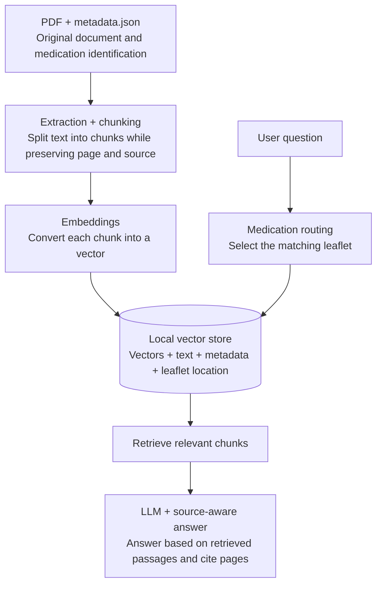

# Medication Leaflet RAG

<p align="center">

</p>

A Python RAG application for asking questions about medication package leaflets. It extracts text from PDF leaflets, splits the text into overlapping chunks, embeds the chunks, retrieves relevant passages, and asks Gemini to answer from those passages with page references.

The application currently supports dipyrone, hydrochlorothiazide, and losartan potassium. It selects a leaflet based on the medication name in the question. The router recognizes English names and common Portuguese names used in the source leaflets.

## How the RAG works



Each leaflet has its own local vector store file under `vector_store/`.

## Requirements

- Python 3.12 or newer
- A Google Gemini API key

## Installation

Run these commands from the project root:

```bash
python3.12 -m venv .venv
source .venv/bin/activate
python -m pip install --upgrade pip
python -m pip install -r requirements.txt
```

Create a `.env` file in the project root and add your Gemini API key:

```dotenv
GOOGLE_API_KEY=your_api_key_here
```

The `.env` file is excluded from Git by `.gitignore`.

## Prepare the leaflet indexes

PDF files and metadata are read from the medication folders under `data/`. Each folder should contain a PDF and a `metadata.json` file. Supported file paths are configured in `src/leaflet_rag/config.py`.

Create any missing indexes without asking a question:

```bash
python main.py --index-only
```

Rebuild all indexes from the PDFs and metadata:

```bash
python main.py --index-only --rebuild
```

The index files are saved to `vector_store/`, which is excluded from Git. Rebuilding is needed after changing a source PDF, its metadata, or the chunking settings.

## Run the application

With `.venv` activated, start the interactive CLI:

```bash
python main.py
```

You can also run the installed command:

```bash
leaflet-rag
```

Enter a question that names one medication, for example:

```text
What are the precautions for losartan?
```

The application selects the corresponding leaflet, retrieves up to five relevant chunks, and asks Gemini to answer in English using only those excerpts. The answer is instructed to cite the page numbers. If the question does not identify exactly one supported medication, the application asks you to specify one.

To rebuild the selected medication's index before asking the question, run:

```bash
python main.py --rebuild
```
